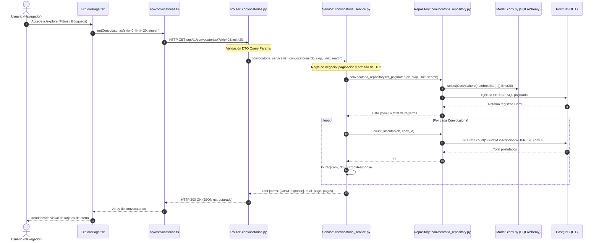

# 🔍 02 — Inventario de Componentes y Trazabilidad Extremo a Extremo

> **Proyecto:** Jóvenes al Ruedo — Web & API  
> **Ficha SENA:** 3171599 (ADSO) | **Fecha:** 2026-11-19  
> **Autores:** Jhoyner Nova & Franky Almario  
> **Patrón Arquitectónico:** Clean Architecture (Capas: Interfaz $\rightarrow$ Controller/Router $\rightarrow$ Service $\rightarrow$ Repository $\rightarrow$ ORM Model $\rightarrow$ PostgreSQL)

---

## 🌊 1. Trazabilidad de la Operación de Consulta: `GET /api/v1/convocatorias/`



### Tabla de Componentes Participantes (Consulta)

| Paso | Capa Lógica | Archivo Físico | Función / Símbolo | Líneas de Código | Responsabilidad Efectiva |
|---|---|---|---|---|---|
| **1** | **Interfaz de Usuario** | `fe/src/pages/ExplorePage.tsx` | Componente `ExplorePage` | L40–L120 | Captura el término de búsqueda del input y la página actual; dispara la llamada HTTP. |
| **2** | **Cliente API Frontend** | `fe/src/api/convocatorias.ts` | `convocatoriasApi.getConvocatorias` | L12–L25 | Construye la petición Axios con query params y timeout de 10s. |
| **3** | **Router / Controller** | `be/app/routers/convocatorias.py` | `list_convocatorias()` | L27–L35 | Recibe la solicitud HTTP, inyecta `db` con `Depends(get_db)`, valida límites y delega al service. |
| **4** | **Capa de Negocio (Service)** | `be/app/services/convocatoria_service.py` | `list_convocatorias()` y `to_dto()` | L34–L65 | Calcula `page`, `pages`, total y orquesta la transformación a DTO `ConvResponse`. |
| **5** | **Capa de Persistencia (Repo)** | `be/app/repositories/convocatoria_repository.py` | `list_paginated()` y `count_inscritos()` | L25–L45 | Construye y ejecuta las sentencias SQLAlchemy `select(Conv)` y `select(func.count())`. |
| **6** | **Contrato DTO (Schema)** | `be/app/schemas/conv.py` | Clase `ConvResponse` | L51–L65 | Valida que la estructura de salida contenga tipos seguros (`id_conv: int`, `nombre: str`, etc.). |
| **7** | **Entidad ORM (Model)** | `be/app/models/conv.py` | Clase `Conv` e `Inscripcion` | L12–L75 | Mapea las columnas de la tabla `conv` (`id_conv`, `nombre`, `glue`, etc.) y relaciones foráneas. |
| **8** | **Motor de Base de Datos** | PostgreSQL 17 (Docker/Podman) | Tabla `conv` e `inscripcion` | Puerto 5433 | Almacena y devuelve los registros relacionales en disco. |

---

## ✍️ 2. Trazabilidad de la Operación de Escritura: `POST /api/v1/auth/register`

```mermaid
sequenceDiagram
    autonumber
    actor U as Joven Artista
    participant UI as RegisterPage.tsx
    participant API as api/auth.ts
    participant MW as Middleware (Limiter / Security)
    participant R as Router: auth.py
    participant DTO as Schema: UserCreate (Pydantic)
    participant S as Service: auth_service.py
    participant SEC as Utils: security.py (bcrypt)
    participant Repo as Repository: user_repository.py
    participant M as Model: user.py (SQLAlchemy)
    participant DB as PostgreSQL 17

    U->>UI: Diligencia formulario de registro (email, edad, clave, términos)
    UI->>API: authApi.register(userData)
    API->>MW: HTTP POST /api/v1/auth/register (JSON Payload)
    Note over MW: Rate Limiter (máximo 5 req/min por IP)
    MW->>R: router.post("/register") -> register()
    R->>DTO: UserCreate.model_validate(json)
    Note over DTO: Invariantes: 18<=edad<=28, clave fuerte, accepted_terms=true
    DTO-->>R: Objeto user_data validado
    R->>S: auth_service.register_user(db, user_data)
    S->>Repo: user_repository.get_by_email(db, email)
    Repo->>DB: SELECT * FROM users WHERE email = ?
    DB-->>Repo: None (No existe duplicado)
    Repo-->>S: None
    Note over S: Regla de paleta: área 'música' -> 'blue'
    S->>SEC: hash_password(password)
    SEC-->>S: $2b$12$... (Hash seguro)
    S->>M: new_user = User(email, first_name, hash, privacy_accepted_at, ...)
    S->>Repo: user_repository.create(db, new_user)
    Repo->>DB: INSERT INTO users VALUES (...) RETURNING *; COMMIT
    DB-->>Repo: Registro persistido con UUID
    Repo-->>S: Entidad User
    S-->>R: Entidad User persistida
    R->>DTO: UserResponse.model_validate(user)
    Note over DTO: Filtra y omite hashed_password
    R-->>API: HTTP 201 Created (JSON UserResponse)
    API-->>UI: Respuesta exitosa
    UI-->>U: Redirección automática a onboarding / dashboard
```

### Tabla de Componentes Participantes (Escritura)

| Paso | Capa Lógica | Archivo Físico | Función / Símbolo | Líneas de Código | Responsabilidad Efectiva |
|---|---|---|---|---|---|
| **1** | **Interfaz de Usuario** | `fe/src/pages/RegisterPage.tsx` | Componente `RegisterPage` | L30–L150 | Captura los campos de formulario, previene acciones de copiar/pegar en contraseña y envía payload. |
| **2** | **Cliente API Frontend** | `fe/src/api/auth.ts` | `authApi.register` | L15–L28 | Envía petición POST con cabecera `Content-Type: application/json`. |
| **3** | **Middleware de Seguridad** | `be/app/core/limiter.py` | `@limiter.limit("5/minute")` | L15–L25 | Aplica política de contención contra ataques de denegación de servicio y fuerza bruta. |
| **4** | **Router / Controller** | `be/app/routers/auth.py` | `register()` | L75–L96 | Endpoint HTTP, delega la validación del body a Pydantic y transfiere el control a `auth_service`. |
| **5** | **Contrato DTO (Schema Entrada)** | `be/app/schemas/user.py` | Clase `UserCreate` | L26–L125 | Valida formato de email, regex de contraseña, cálculo estricto de edad (18 a 28 años) y `accepted_terms`. |
| **6** | **Capa de Negocio (Service)** | `be/app/services/auth_service.py` | `register_user()` | L40–L105 | Orquesta el flujo: verifica unicidad, aplica paleta de diseño según disciplina artística y timestamp de privacidad. |
| **7** | **Criptografía / Utilidades** | `be/app/utils/security.py` | `hash_password()` | L25–L35 | Aplica algoritmo de derivación de claves `bcrypt` con 12 rondas de salt. |
| **8** | **Capa de Persistencia (Repo)** | `be/app/repositories/user_repository.py` | `get_by_email()` y `create()` | L23–L35 | Ejecuta consultas atómicas de verificación e inserción con `db.add()`, `db.commit()` y `db.refresh()`. |
| **9** | **Entidad ORM (Model)** | `be/app/models/user.py` | Clase `User` | L21–L280 | Mapea la tabla `users`, definiendo tipos UUID, constraints de unicidad y marcas de tiempo UTC. |
| **10** | **Contrato DTO (Schema Salida)** | `be/app/schemas/user.py` | Clase `UserResponse` | L287–L320 | Filtra y formatea los datos públicos del usuario, garantizando que el hash de contraseña jamás salga de la API. |
| **11** | **Motor de Base de Datos** | PostgreSQL 17 (Docker/Podman) | Tabla `users` | Puerto 5433 | Persiste la tupla con integridad ACID y unicidad de clave foránea. |
